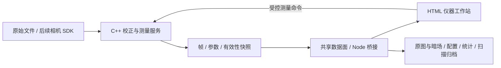
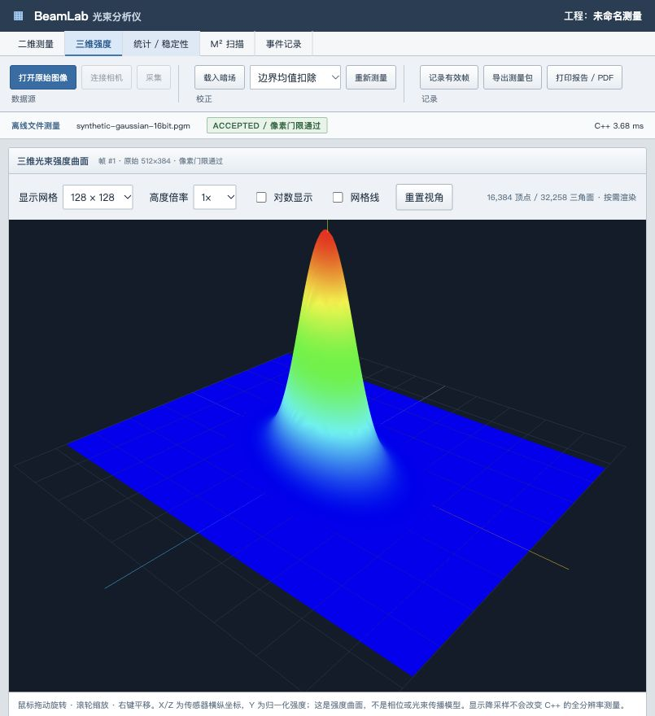
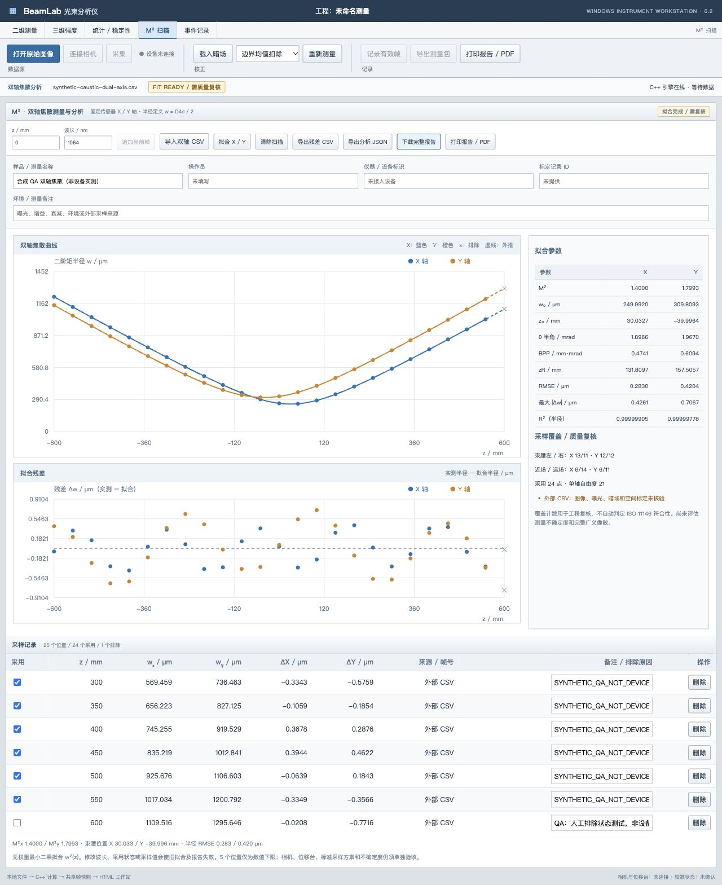
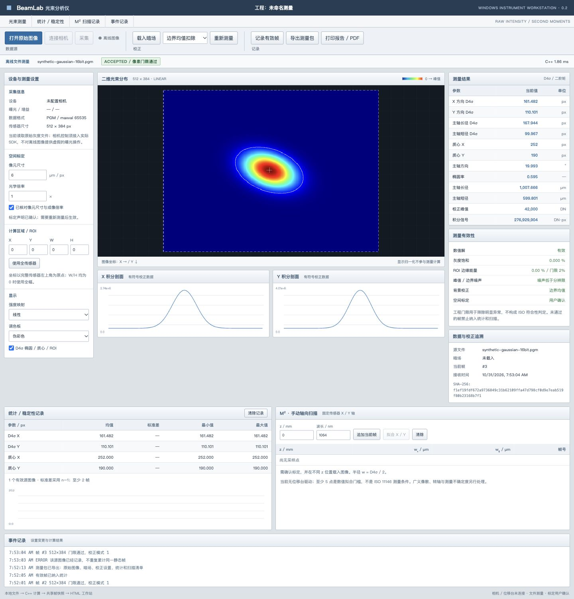

# BeamLab · 光束分析仪软件

面向 **Windows x64 工控机**的仪器测量工作站：**C++ 数值与设备服务 + HTML 界面 + Electron 桌面容器**。相机尚未选型，采集层按可替换适配器设计。

## 产品方向

参考 Thorlabs Beam / Ophir BeamGage 的仪器工作流组织界面与数据链，重点是原始输入、校正、测量有效性、参数统计、轴向扫描和结果可追溯。[产品需求规格](docs/PRD.md)与[软件架构](docs/ARCHITECTURE.md)区分当前实现和设备版目标。



## 分页与 Three.js 三维视图

工作站按 `/measurement`、`/surface`、`/statistics`、`/scan`、`/events` 分为独立页面，当前帧、统计及扫描记录在页内导航和浏览器前进/后退时保留；刷新页面暂不恢复会话。

三维页显示同一 C++ 校正帧的全传感器强度曲面，支持旋转、缩放、平移、线性/对数、线框和高度倍率。它表示强度，不表示相位或传播波面。

Three.js 本地依赖、按需加载；默认 128×128 网格、最高 256×256；显示降采样不改变 C++ 原始分辨率测量。复用几何缓冲、限制设备像素比，页面隐藏或无操作时不运行连续渲染循环。采集、计算、内存传输仍需各自做性能验证。



## M² 双轴扫描与报告

`/scan` 支持有效标定帧逐点登记，或导入 `z_mm,wx_um,wy_um,included,note` CSV（后三列中的 included/note 可省略）。C++ 分别拟合固定 X/Y 轴，页面显示双轴焦散、半径残差、M²、束腰、发散角、BPP、瑞利长度、RMSE、R²及采样覆盖提示。支持人工排除并保留原因，修改采样或波长后旧拟合立即失效。

可导出残差 CSV、分析 JSON 和独立 HTML 完整报告；打印入口支持浏览器另存 PDF。报告包含测量元信息、方法、双轴结果、两张矢量曲线、全部采用/排除点、来源哈希和事件记录。它是分析记录，计量不确定度及标准符合性仍待验证。



## 本轮已实现

- 读取 8/16-bit 二进制 PGM，保留灰度动态范围；默认空设备、空图像，不自动生成演示光斑。
- C++ 矩形 ROI、有符号边界背景/暗场扣除、固定 X/Y 与主轴 D4σ、质心、椭圆率、方向。
- 饱和、边缘能量、信噪与数值有效性工程检查；未通过帧禁止记录，未确认标定时不显示物理尺寸。
- 二维光斑、ROI/椭圆/质心、像素读数、X/Y 积分剖面、线性/对数及灰度/伪彩显示。
- 有效帧统计、质心趋势、手动 z 样本与固定双轴焦散拟合。
- 包含原始 PGM、暗场、配置、来源哈希、结果和扫描记录的 ZIP 会话导出；网页打印审核视图。
- POSIX mmap 与 Windows 文件映射后端代码；当前 Node 端仍复制快照，**不是端到端零拷贝**。

**尚未完成整机部署：**真实相机与位移台、TIFF16/厂商格式、曝光/暗场条件绑定、自动扫描、正式计量报告、标准符合性及 Windows 实机验证仍在后续阶段。当前工程门限不等同于 ISO 11146 认证。

## 工作站实图

以下为当前实现载入合成 QA 图后的实际页面，不是相机采集或设备精度证据。默认启动为空设备、空图像。



## 本地运行

Node.js 22+，C++17 编译环境。macOS/Linux 可使用 `c++`；Windows 需要 CMake 3.16+ 和 Visual Studio 2022 C++ x64 工具链。

```sh
npm ci --omit=dev
npm run build
npm test
npm start
```

浏览器打开终端输出地址，默认 `http://127.0.0.1:4318`。当前开发验收实例可使用 `PORT=4319` 区分原演示服务。

### Electron

```sh
npm ci
npm run build
npm run desktop
```

Electron 开发依赖固定在 package/lock 文件中。桌面容器已编写，但本轮未获得可核验的 Electron 窗口运行结果；Windows 必须单独编译、加载和退出验收。当前页面与数据链已在 macOS 浏览器验证。

### 文件测量

1. 打开原始 P5 PGM；尺寸 8–2048 px/轴、满量程 1–65535，16-bit 样本采用 PGM 规定的大端格式。
2. 设置 ROI 和背景校正，或载入匹配尺寸/满量程的暗场。PGM 不含相机设置，暗场曝光/增益条件须自行核实。
3. 核对像元尺寸和倍率并确认标定；否则只显示像素值。
4. 检查有效性项，再记录、追加 z 位置或导出会话。
5. 测量包包含本次会话原图及暗场，当前原图暂存上限 64 MiB；没有将暂存会话自动持久化或恢复的功能。

`tests/fixtures/` 是明确标记的合成 QA 图，不代表设备数据，也不默认载入。历史 Python 数值对照在 `reference/python/`。

## 关键代码

| 路径                             | 用途                                          |
| -------------------------------- | --------------------------------------------- |
| `native/include/measurement.hpp` | 原始图像解码、有符号校正、ROI、二阶矩与质量量 |
| `native/include/beam.hpp`        | 历史对照路径与焦散拟合                        |
| `native/src/worker.cpp`          | 跨平台映射、测量命令与结果发布                |
| `desktop/server.mjs`             | 输入验证、帧一致性、原图归档与 API            |
| `desktop/session-archive.mjs`    | ZIP 会话归档                                  |
| `desktop/main.cjs`               | Electron 窗口与服务生命周期                   |
| `web/`                           | HTML 仪器工作站                               |
| `tests/`、`native/tests/`        | 数值、原始位深、有效性与通道回归              |

验证命令、已知限制与实测范围见 [VALIDATION.md](docs/VALIDATION.md)。
