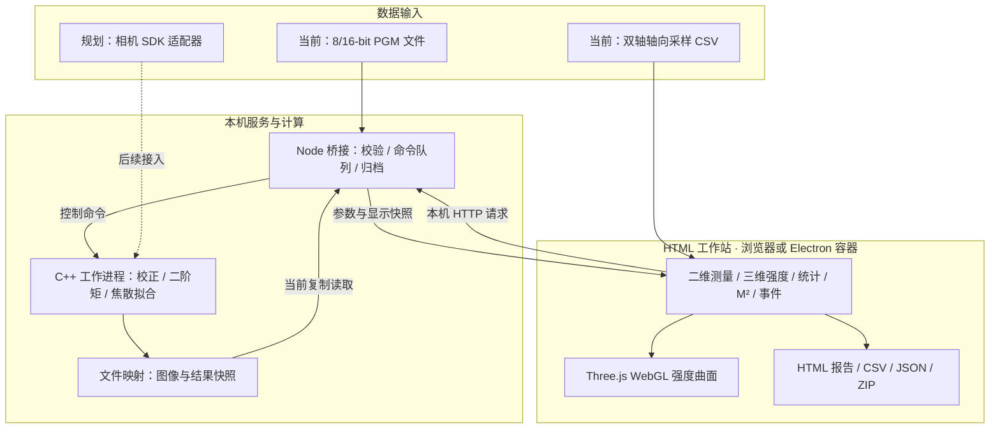

# BeamLab · 光束分析仪软件

面向 **Windows x64 工控机**的仪器测量工作站：**C++ 数值与设备服务 + HTML 界面 + Electron 桌面容器**。相机尚未选型，采集层按可替换适配器设计。

## 项目定位与版本状态

BeamLab 用于搭建光束分析仪的本地测量软件，覆盖二维光斑观察、三维强度显示、光束参数计算、稳定性统计、轴向焦散分析和报告归档。目标使用场景是实验室及工业现场的激光光束调试、测量与结果复核。

当前发布为 **[v0.2.0 工程预览版](https://github.com/aruchid/laser-beam-analyzer/releases/tag/v0.2.0)**，提供源码及本地构建流程。已经打通离线原始文件到 C++ 计算、页面分析和报告导出的链路；相机与位移台尚未选型和接入，暂不提供 Windows 安装包。后续真实设备采集沿用同一测量与显示架构。

## 设计方向

参考 Thorlabs Beam / Ophir BeamGage 的仪器工作流组织界面与数据链，重点是原始输入、校正、测量有效性、参数统计、轴向扫描和结果可追溯。[产品需求规格](docs/PRD.md)与[软件架构](docs/ARCHITECTURE.md)区分当前实现和设备版目标。



C++ 负责原始分辨率数值计算，HTML/Canvas/Three.js 负责交互与显示；Electron 提供桌面容器。当前数据通路使用文件映射、Node 快照复制及本机 HTTP，尚未实现端到端零拷贝。详细协议见 [ARCHITECTURE.md](docs/ARCHITECTURE.md)。

## 页面与用途

| 页面 | 路径 | 主要用途 |
| --- | --- | --- |
| 二维测量 | `/measurement` | 原图导入、校正、ROI、光斑与剖面、参数及有效性复核 |
| 三维强度 | `/surface` | 同一校正帧的 WebGL 强度曲面、旋转缩放与显示设置 |
| 统计 / 稳定性 | `/statistics` | 有效帧登记、参数统计和质心趋势 |
| M² 扫描 | `/scan` | z 位置采样、双轴焦散拟合、残差和完整报告 |
| 事件记录 | `/events` | 操作、拒绝原因与异常事件复核 |


## 分页与 Three.js 三维视图

工作站按 `/measurement`、`/surface`、`/statistics`、`/scan`、`/events` 分为独立页面，当前帧、统计及扫描记录在页内导航和浏览器前进/后退时保留；刷新页面暂不恢复会话。

三维页显示同一 C++ 校正帧的全传感器强度曲面，支持旋转、缩放、平移、线性/对数、线框和高度倍率。它表示强度，不表示相位或传播波面。

Three.js 本地依赖、按需加载；默认 128×128 网格、最高 256×256；显示降采样不改变 C++ 原始分辨率测量。复用几何缓冲、限制设备像素比，页面隐藏或无操作时不运行连续渲染循环。采集、计算、内存传输仍需各自做性能验证。


## M² 双轴扫描与报告

`/scan` 支持有效标定帧逐点登记，或导入 `z_mm,wx_um,wy_um,included,note` CSV（`included` 和 `note` 可省略）。C++ 分别拟合固定 X/Y 轴，页面显示双轴焦散、半径残差、M²、束腰、发散角、BPP、瑞利长度、RMSE、R²及采样覆盖提示。支持人工排除并保留原因，修改采样或波长后旧拟合立即失效。

可导出残差 CSV、分析 JSON 和独立 HTML 完整报告；打印入口支持浏览器另存 PDF。报告包含测量元信息、方法、双轴结果、两张矢量曲线、全部采用/排除点、来源哈希和事件记录。它是分析记录，计量不确定度及标准符合性仍待验证。


## 已实现能力

- 读取 8/16-bit 二进制 PGM，保留灰度动态范围；默认空设备、空图像，不自动生成演示光斑。
- C++ 矩形 ROI、有符号边界背景/暗场扣除、固定 X/Y 与主轴 D4σ、质心、椭圆率、方向。
- 饱和、边缘能量、信噪与数值有效性工程检查；未通过帧禁止记录，未确认标定时不显示物理尺寸。
- 二维光斑、ROI/椭圆/质心、像素读数、X/Y 积分剖面、线性/对数及灰度/伪彩显示。
- 有效帧统计、质心趋势、手动 z 样本与固定双轴焦散拟合。
- 包含原始 PGM、暗场、配置、来源哈希、结果和扫描记录的 ZIP 会话导出；网页打印审核视图。
- POSIX mmap 与 Windows 文件映射后端代码；当前 Node 端仍复制快照，**不是端到端零拷贝**。

**尚未完成整机部署：**真实相机与位移台、TIFF16/厂商格式、曝光/暗场条件绑定、自动扫描、正式计量报告、标准符合性及 Windows 实机验证仍在后续阶段。当前工程门限不等同于 ISO 11146 认证。

## 工作站实图

以下为当前实现载入合成 QA 图后的实际页面，不是相机采集或设备精度证据。默认启动为空设备、空图像。


## 本地运行

Node.js 22+，C++17 编译环境。macOS/Linux 可使用 `c++`；Windows 需要 CMake 3.16+ 和 Visual Studio 2022 C++ x64 工具链。

```sh
npm ci --omit=dev
npm run build
npm test
npm start
```

浏览器打开终端输出地址，默认 `http://127.0.0.1:4318`。端口可按需修改：

```sh
# macOS / Linux
PORT=4319 npm start
```

```powershell
# Windows PowerShell
$env:PORT = "4319"
npm start
```

Windows 建议在 Visual Studio 2022 的 x64 开发者终端中构建，确保 CMake 与 C++ 编译工具可用。使用 `Ctrl+C` 停止本地服务。

### Electron

```sh
npm ci
npm run build
npm run desktop
```

Electron 开发依赖固定在 package/lock 文件中。桌面容器已编写，但本轮未获得可核验的 Electron 窗口运行结果；Windows 必须单独编译、加载和退出验收。当前页面与数据链已在 macOS 浏览器验证。

### 文件测量

1. 打开原始 P5 PGM；尺寸 8–2048 px/轴、满量程 1–65535，16-bit 样本采用 PGM 规定的大端格式。
2. 设置 ROI 和背景校正，或载入匹配尺寸/满量程的暗场。PGM 不含相机设置，暗场曝光/增益条件须自行核实。
3. 核对像元尺寸和倍率并确认标定；否则只显示像素值。
4. 检查有效性项，再记录、追加 z 位置或导出会话。
5. 测量包包含本次会话原图及暗场，当前原图暂存上限 64 MiB；没有将暂存会话自动持久化或恢复的功能。

`tests/fixtures/` 是明确标记的合成 QA 图，不代表设备数据，也不默认载入。历史 Python 数值对照在 `reference/python/`。

## M² 分析操作流程

1. 进入 `/scan`，填写波长、测量名称、操作员、设备标识、标定记录及环境信息。
2. 逐张导入不同 z 位置的有效标定图像并追加当前帧；或导入已有双轴半径 CSV。两种来源不在同一扫描中混用。
3. 复核测点；需要排除时取消采用并填写原因。至少 5 个不同 z 位置才能拟合，这只是数值输入下限，不能代替标准采样方案。
4. 点击“拟合 X / Y”，检查曲线、残差、束腰位置及近远场覆盖提示。单帧光斑不能得到这里的焦散法 M²。
5. 导出报告与分析数据。修改波长、采用状态或备注后须重新拟合，再导出对应的新结果。

CSV 使用 UTF-8，第一行必须包含字段名；`z_mm` 为轴向位置，`wx_um`、`wy_um` 为固定传感器 X/Y 轴的二阶矩**半径** `D4σ/2`。可选 `included` 为 1（采用）或 0（排除），`note` 为备注。示意格式如下，实际拟合须提供足够测点：

```csv
z_mm,wx_um,wy_um,included,note
-100,350.2,331.0,1,
0,256.4,319.7,1,
100,282.8,415.2,0,排除原因
```

同一扫描不得重复 z 位置，最多 512 点。外部 CSV 保留文件 SHA-256，但软件无法由半径表核验原始图像、曝光和空间标定。完整合成验收样本见 [双轴焦散 CSV](tests/fixtures/synthetic-caustic-dual-axis.csv)。

## 导出内容与数据保存

| 导出项 | 内容 | 使用方式 |
| --- | --- | --- |
| 测量包 ZIP | 原始 PGM、暗场、manifest、配置、统计及扫描记录 | 留存原始数据及测量上下文 |
| M² 残差 CSV | 全部采用/排除点、拟合半径、双轴残差、来源哈希 | 复算与外部分析 |
| M² 分析 JSON | 波长、双轴拟合结果、采样与诊断 | 结构化结果留存 |
| 完整 HTML 报告 | 元信息、方法、参数、矢量曲线、全量测点及溯源 | 独立打开、审核与归档 |
| 打印 / PDF | 专用报告打印版式 | 由浏览器打印对话框选择另存 PDF |

页内导航保留当前会话，**刷新或关闭页面不会自动恢复会话**。请及时导出；当前没有工程文件导入恢复功能。HTML 报告不替代原始图像归档，外部 CSV 分析也不会生成不存在的原图。

## 验证范围与后续工作

v0.2.0 已通过 Windows、macOS、Linux 的 C++ 编译及自动回归；浏览器功能用合成数据验证。详细证据见 [验证记录](docs/VALIDATION.md) 和 [发布版本 CI](https://github.com/aruchid/laser-beam-analyzer/actions/runs/41256940766)。CI 通过不代表目标工控机、相机或位移台已经验收。

后续设备版重点：

- 相机 SDK、曝光/增益/触发、断线重连及暗场条件绑定。
- 位移台回零、限位、位置反馈、稳定等待和自动扫描。
- 标准采样设计、测量不确定度、参考仪器对比及完整广义像散方法。
- Windows 实机性能、Electron 安装包、长时间运行及异常恢复。
- TIFF16/厂商格式、可恢复工程文件及长期归档。

## 文档导航

- [产品需求规格](docs/PRD.md)：功能要求、状态语义与实施阶段。
- [软件架构与协议](docs/ARCHITECTURE.md)：进程、数据传输及设备版设计。
- [验证记录](docs/VALIDATION.md)：测试方法、实际验收及未验收项目。
- [发布版本](https://github.com/aruchid/laser-beam-analyzer/releases)：版本说明与源码下载。

## 关键代码

| 路径                             | 用途                                          |
| -------------------------------- | --------------------------------------------- |
| `native/include/measurement.hpp` | 原始图像解码、有符号校正、ROI、二阶矩与质量量 |
| `native/include/beam.hpp`        | 历史对照路径与焦散拟合                        |
| `native/src/worker.cpp`          | 跨平台映射、测量命令与结果发布                |
| `desktop/server.mjs`             | 输入验证、帧一致性、原图归档与 API            |
| `desktop/session-archive.mjs`    | ZIP 会话归档                                  |
| `desktop/main.cjs`               | Electron 窗口与服务生命周期                   |
| `web/`                           | HTML 仪器工作站                               |
| `tests/`、`native/tests/`        | 数值、原始位深、有效性与通道回归              |

验证命令、已知限制与实测范围见 [VALIDATION.md](docs/VALIDATION.md)。
