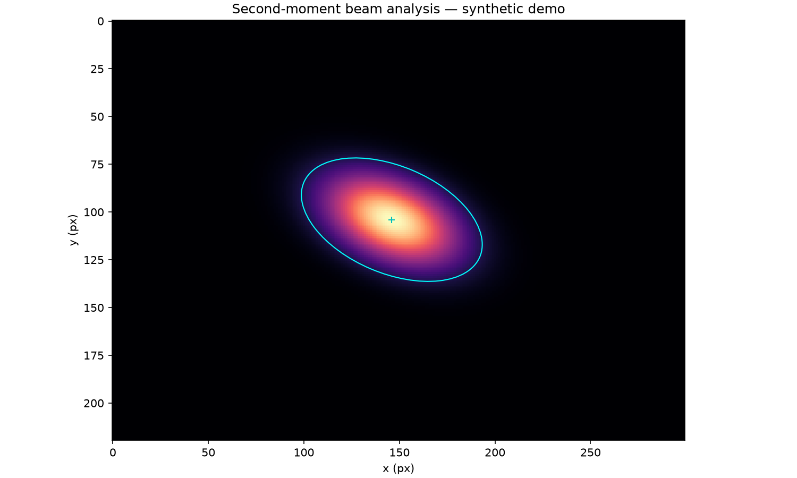

# 激光光束二阶矩分析原型

这是从零实现的最小数值原型，默认运行确定性合成样例。

## 安装与运行

需要 Python 3.11+。

```sh
python -m venv .venv
source .venv/bin/activate
pip install -r requirements.txt
python src/beam.py --background 3 --output artifacts
```

## 自有数据

二维灰度 NumPy `.npy` 文件，背景值由 --background 指定；输出质心、主轴 D4σ 直径和二阶矩协方差。测量单位为像素；需要校准后才能转为物理尺寸。

```sh
python src/beam.py --input your-data.npy --background 3 --output artifacts
```

## 实际运行结果

下面是当前代码生成的合成样例结果图，不是设备实测或 UI 截图。



## 文档

- [PRD](docs/PRD.md)
- [验证记录](docs/VALIDATION.md)

## 限制

尚未接入真实硬件或现场数据，未提供实时界面；生产性能和测量不确定度待验证。原有文档中的概念架构图与本原型运行结果分开保存。
