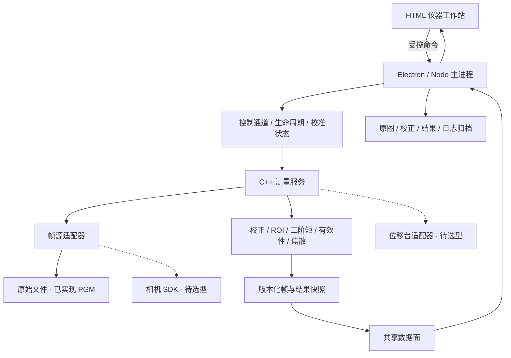

# BeamLab 光束分析仪软件：产品需求规格

版本 0.2 · 2026-10-31 · 主部署目标：**Windows 10/11 x64 工控机**。相机尚未选型，采集层采用可替换适配器。本规格替代原演示工作台方案。

## 1. 产品定义

本产品是光束分析仪的操作与测量软件。C++ 负责采集、图像处理、数值计算与设备控制；HTML/CSS/JavaScript 负责仪器操作界面；Electron 提供桌面容器与进程管理。用户启动的是测量工作站，不是算法教学页。

核心交付是可复核的测量链：**设备/原始文件 → 校正状态 → 计算区域 → 光束参数 → 有效性判定 → 稳定性或轴向扫描 → 原始数据与报告**。界面专业化必须对应数据和状态语义，不能用不可执行的按钮或固定数字代替硬件能力。

### 产品边界

- 不以相机像素积分替代绝对功率；功率密度必须另有波长、传感器响应、衰减、曝光和功率标定。
- 单帧强度分布不能提供本产品焦散法所需的 M²。
- 工程有效性门限不等于 ISO 11146 符合性认证。
- 当前未连接真实相机或位移台。离线文件测量与实时设备测量须在界面、结果及导出中持续区分。

## 2. 参考产品与设计取舍

参考功能组织与测量工作流，不复制品牌视觉资产或声称复现厂商专有校正算法。

| 参考           | 公开资料中的能力                                                       | 本产品要求                                                  |
| -------------- | ---------------------------------------------------------------------- | ----------------------------------------------------------- |
| Thorlabs Beam  | 可组合的二维/剖面/参数窗口、光束位置与宽度时间分析、光束质量和文件输出 | 高信息密度、多视图同步、固定单位、扫描和结果复核            |
| Ophir BeamGage | 背景基线处理、曝光设置、实时统计、测量工作区                           | 校正状态为一等数据；曝光/饱和、统计门禁和数值有效性贯穿流程 |

官方依据：[Thorlabs 光束分析功能资料](https://www.thorlabs.com/images/Catalog/V21/V21_7_LightAnalysis.pdf)、[Ophir BeamGage 官方资料](https://www.ophiropt.com/medias/sys_master/opresources/haa/h14/9944423039006/BeamGage/BeamGage.pdf)。这些资料包括历史版本的功能说明，用于工作流研究，不据此宣称当前版本功能或性能完全一致。

## 3. 操作场景与状态机

### 设备测量

枚举设备 → 连接并核对传感器信息 → 预热 → 设置曝光/增益/触发 → 遮光并采集暗场 → 打开光路、检查饱和与视场 → 确认空间标定 → 测量、记录、扫描、导出。

设备状态：`Disconnected → Connecting → Idle → Acquiring → Stopping → Idle`，各阶段可进入 `Fault`。禁止在无设备时显示采集成功；断线必须终止有效帧发布，并明确最后有效数据的时间。

当前相机未选型：界面如实显示“未配置相机”，设备连接、曝光和采集保持不可用；通过文件输入路径推进算法与完整数据闭环。

### 离线文件测量

载入原始灰度文件 → 确认数据位深/满量程/尺寸 → 选择背景方式和 ROI → 核对像元尺寸/倍率 → 执行测量 → 检查质量项 → 手动登记有效帧 → 导出包含原始图像的会话包。

文件状态：`Empty → Loading → Ready/Rejected`。设置变更进入 `Dirty`，重新计算完成前，旧结果可供参考但不能记录或导出为当前结果。失败不产生成功帧。

## 4. 工作站界面

面向 1280×800 以上工控机，主验证尺寸 1440×1000；浅色仪器布局、紧凑表格、分组工具栏、固定状态栏，关键测量不依赖长段解释。

| 区域       | 信息与操作                                                                    |
| ---------- | ----------------------------------------------------------------------------- |
| 工具栏     | 原始文件、设备连接/采集、暗场、重新测量、有效帧记录、会话导出、打印报告       |
| 左设置区   | 设备/曝光/增益/格式、空间标定、ROI、显示强度映射与调色板                      |
| 中央图形区 | 完整传感器坐标、计算 ROI、D4σ 椭圆、质心、像素读数、X/Y 积分剖面              |
| 右测量区   | 固定 X/Y 宽度、主轴长短径、质心、方向、椭圆率、单位、质量状态、来源与暗场哈希 |
| 下工作区   | 有效帧统计、质心趋势、手动 z 扫描与双轴拟合、事件记录                         |
| 状态栏     | 数据源、当前帧、计算耗时、标定/连接状态；旧数据或离线数据不冒充实时           |

显示归一化、伪彩/灰度、线性/对数切换只改变图形，不改变数值结果。后续增加可移动剖切线、像素直方图、2D/3D 工作区和可保存布局。

## 5. 测量链与算法要求

### 原始输入与预处理

1. 原始输入须保留有效位深、满量程、行步长、帧号和采集设置。
2. 禁止经浏览器 Canvas 的 8-bit 转换后再当作 12/16-bit 原始测量数据。
3. 校正过程保留有符号浮点值，背景负噪声不可为显示好看而直接截零。显示器可以单独裁零。
4. 区分传感器 ROI、计算区域和显示视窗。首版实现固定传感器坐标下的矩形计算 ROI。
5. 空间尺度为像元尺寸/成像倍率。未核对标定时只输出像素尺寸，禁止追加物理焦散样本。

### 背景与暗场

- 当前：边界带均值扣除；或用户导入逐像素暗场；或明确选择不校正。
- 边界带宽取短边的 1/10，上限 8 px、下限 1 px。需提示光束尾部进入边界会污染背景估计。
- 当前暗场仅核对尺寸和 PGM 满量程，**无法从 PGM 获得曝光、增益、温度或相机身份**。需要操作员确认同一采集条件，不能将尺寸匹配视作仪器级暗场有效证明。
- 新源图像导入会使当前暗场引用失效。设备版应以相机序列号、曝光、增益、ROI、像素格式、温度范围和校准 ID 绑定暗场；任一关键设置变更触发失效。
- 后续：多帧暗场均值/方差、坏点图、背景残差验证、漂移与校准有效期。

### 二阶矩

对有符号校正强度 S 计算 `P=ΣS`、质心与二阶中心矩；协方差特征值给出主轴 `D4σ=4√λ`，同时输出固定传感器 X/Y 轴的 `4√σxx`、`4√σyy`。主轴排序不能替代固定 X/Y 焦散轴，否则跨位置排序可能造成轴交换。

拒绝总信号非正、非有限输入、质心离开 ROI、非正定协方差等非物理解。近圆光斑的主轴方向退化，后续应输出方向有效性而不是假设角度可作高精度姿态。

### 有效性与统计门禁

当前工程筛选条件：数值解有效；执行背景校正；ROI 内无满量程像素；边界正强度占比 <2%；峰值/边界标准差 ≥10（噪声低于分辨限时单独显示，不输出无穷 SNR）。这些是首版启发式门限，须用真实传感器验证并改为受控配置，不声称来自 ISO 标准。

未通过帧可显示和导出用于诊断，不允许纳入统计或扫描。未标定帧可在像素域进行统计；物理尺寸与扫描记录须单独满足标定条件。

同一源文件哈希不重复计数；ROI、背景方式、暗场或标定改变后不混入既有统计。样本标准差使用 n−1，单样本不报告标准差。当前会话最多手动登记 1000 个源图像，后续实时统计采用稳定在线算法及有界历史缓冲。

### M² 扫描

- 记录每个 z 位置的原始图像哈希、时间、标定与计算配置、固定 X/Y 二阶矩半径及有效性状态。
- 禁止同一位置重复登记或同一静态源文件冒充多个位置。
- 焦散输入半径为 `D4σ/2`，不是标准差或直径；z 使用 mm、半径 μm、波长 nm，C++ 内转换 SI。
- 用 `w²(z)` 的二次模型恢复束腰、束腰位置和发散半角，`M²=πw0θ/λ`；返回残差 RMSE。
- 目前分别拟合固定 X/Y 轴，不覆盖完整广义像散测量。5 个不同 z 是算法输入下限，不是标准要求的采样设计。
- 后续实现移动台回零/限位/稳定等待/位置反馈/取消、预扫描、采样覆盖验证、权重拟合、残差图、置信区间与测量不确定度预算。

## 6. 数据与报告

会话包采用 ZIP：`manifest.json` + `raw/<sha256>.pgm`。源图像与暗场保持原始字节，元数据记录单位、来源、ROI、校正模式、标定声明、帧号、统计、扫描样本、拟合和软件版本。当前会话原始文件暂存限额 64 MiB；超限要求先导出后开启新会话，不静默丢失已有数据。

当前网页打印输出可用于审核视图，不是已设计完成的计量证书。正式 PDF 报告需包含设备/镜头/衰减/标定 ID、操作者、测量环境、有效性、采样图、拟合残差和标准适用性说明。后续工程文件须可恢复会话，并有版本迁移与完整性核验。

## 7. 软硬件架构

详细传输协议和 Windows 演进设计见 [ARCHITECTURE.md](ARCHITECTURE.md)。Windows native 映射和 CMake x64 路径已通过 Windows CI 编译及通道测试；本地页面验收在 macOS 完成，目标 Windows 工控机和 Electron 桌面仍须实机验收。

## 8. 实施与验收矩阵

| 项目                         | 本轮状态                         | 必须补齐的设备验收                       |
| ---------------------------- | -------------------------------- | ---------------------------------------- |
| 仪器工作站布局与空设备状态   | 已实现，桌面浏览器检查           | Windows DPI/触屏/键盘与 Electron 实机    |
| C++ 8/16-bit PGM 文件分析    | 已实现；端序、截断输入和恢复测试 | TIFF16/RAW/厂商格式、相机位深与行步长    |
| ROI、有符号暗场/边界校正     | 已实现                           | 真实噪声、温漂、背景污染、坏点与曝光绑定 |
| 二阶矩、固定轴与主轴参数     | 已实现，解析样例恢复测试         | 标准样本与参考软件交叉验证、误差预算     |
| 饱和/边缘/信噪质量门禁       | 已实现工程规则                   | 真实传感器门限与失效检测研究             |
| 统计和手动双轴扫描记录       | 已实现                           | 实时统计、自动扫描、采样覆盖、异常点处理 |
| 原图 + 元数据 ZIP 会话包     | 已实现                           | 会话恢复、正式报告、断电恢复与归档策略   |
| Windows 文件映射 / CMake x64 | Windows CI 编译与通道回归通过    | 目标工控机、中文用户目录、DPI 与桌面回归 |
| 相机 / 位移台                | 未实现，接口方案待设备选型       | 真实硬件、SDK、曝光/触发、断连与限位     |
| 高吞吐共享内存消费           | 设计阶段                         | Native 映射消费者、环形缓冲、测量基准    |

### 阶段完成标准

- A：离线测量链路可追溯；本轮推进至此，不宣称整机完成。
- B：Windows + 已选相机闭环；原始位深、曝光/触发与暗场状态真实可靠。
- C：实时稳定性与吞吐量；按实际分辨率提供端到端 p50/p95、丢帧、CPU/内存和持续运行结果。
- D：位移台扫描、计量方法验证、报告与整机回归。

待选型数据：相机传感器波段/像元/位深/快门/触发、接口和 SDK；光路倍率与衰减；目标帧率；位移台行程/精度/协议；参考仪器与实测数据。相机未选型时不绑定特定品牌 SDK，也不承诺其设备功能。
